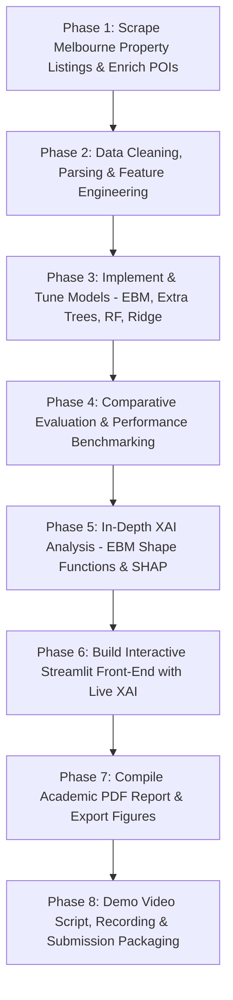

# Machine Learning Assignment: Final Project Plan (Approved Strategy)

## Executive Summary & Objectives
This document establishes the comprehensive execution plan for the **MSc in AI Machine Learning Assignment**, tailored directly to the assignment guidelines, lecture syllabus, and user specifications.

### Core Specifications & Constraints Checklist
- [x] **Hyper-Local Dataset**: Scrape/compile real estate market data for **Melbourne Eastern Suburbs (centered around Burwood East)**.
- [x] **Amenity & POI Feature Enrichment**: Integrate external drivers of local property value:
  - Top school zones (e.g., Mount Waverley Secondary, Glen Waverley Secondary, Deakin University).
  - Major shopping hubs & supermarkets (Burwood Brickworks, Burwood One 24h Kmart/Coles, The Glen, Box Hill Central).
  - Public transport access (Tram Route 75, Glen Waverley & Belgrave/Lilydale railway lines).
  - Distance to Melbourne CBD (~17–20 km).
- [x] **Two "New" Algorithms Evaluated & Compared** (strictly not in lecture/lab syllabus & non-deep-learning):
  1. **Explainable Boosting Machine (EBM / $GA^2M$)** (Glass-box additive boosting with pairwise interactions).
  2. **Extra Trees Regressor (Extremely Randomized Trees)** (Randomized threshold variance-reduction ensemble).
- [x] **Standard Baselines for Scientific Rigor**:
  - Linear/Ridge Regression (`sklearn.linear_model.Ridge`).
  - Standard Random Forest Regressor (`sklearn.ensemble.RandomForestRegressor`).
- [x] **Explainability (XAI)**: EBM 1D shape functions, 2D interaction heatmaps, and SHAP summary & waterfall plots.
- [x] **Bonus Front-End Integration (+10 Marks)**: Interactive **Streamlit** dashboard with live valuation, what-if amenity/renovation simulator, and real-time XAI visualizations.
- [x] **Deliverables**: Academic PDF report, modular code repository, dataset with documentation, and 3–5 min demo video.

---

## 1. Problem Formulation & Hyper-Local Dataset Collection (15 Marks)

### Problem Definition
* **Problem**: Precision Property Valuation & Price Driver Analysis in Melbourne’s Middle Eastern Suburbs.
* **Target Area**: **Burwood East** and surrounding high-demand eastern suburbs:
  * *Core Suburbs*: Burwood East (3151), Burwood (3125), Mount Waverley (3149), Glen Waverley (3150), Box Hill (3128), Box Hill South (3128), Blackburn (3130), Blackburn South (3130), Forest Hill (3131), Vermont (3133), Vermont South (3133).
* **Target Variable**: Continuous property sale/listing price (`price_aud`) and price per square meter (`price_per_sqm`).

### Feature Schema & Enrichment (What Drives Melbourne Property Prices?)
1. **Structural & Property Attributes (Scraped)**:
   * `suburb`, `postcode`, `property_type` (House, Unit/Apartment, Townhouse).
   * `bedrooms`, `bathrooms`, `parking_spaces`.
   * `land_size_sqm`, `building_size_sqm`.
2. **Key Local Amenity & Infrastructure Drivers (Enriched POI Features)**:
   * **Education & School Catchment Zones**:
     * In-zone indicator & distance to top state schools: *Mount Waverley Secondary College (MWSC)*, *Glen Waverley Secondary College (GWSC)*, *Box Hill High School*.
     * Distance to Tertiary Education: *Deakin University (Burwood Campus)*.
   * **Retail & Commercial Hubs**:
     * Distance to *Burwood Brickworks* (world's most sustainable shopping centre).
     * Distance to *Burwood One Shopping Centre* (Burwood Hwy & Blackburn Rd).
     * Distance to major activity centers: *The Glen* and *Box Hill Central*.
     * Distance to nearest major supermarket (Coles, Woolworths, Aldi).
   * **Public Transport & Accessibility**:
     * Distance to Route 75 Tram line along Burwood Highway (direct route to CBD/Docklands).
     * Distance to nearest Railway Station (e.g. Mount Waverley, Glen Waverley, Box Hill, Blackburn).
     * Straight-line & road distance to Melbourne CBD (GPO).

### Web Scraping & Data Pipeline Design (`src/scraper.py` & `src/enrich_poi.py`)
* **Scraper**: Collects property listings from public listing portals for targeted postcodes (3125, 3128, 3130, 3131, 3133, 3149, 3150, 3151).
* **Polite Crawling Protocol**: Custom user-agent, randomized 1.5–3.0s delays, exponential backoff, compliance with `robots.txt`.
* **Spatial POI Engine**: Uses exact geodesic coordinates (haversine formula) to calculate distances between property locations and verified Melbourne POI landmark coordinates.
* **Ethical Compliance**: Strictly publicly available property data; zero harvesting of personal names, phone numbers, or private vendor details.

---

## 2. Selection & Theoretical Justification of the New ML Algorithms (15 Marks)

### Syllabus Verification (`covered-algo.txt`)
* Covered in course: Linear Regr, SGD Regr, Logistic Regr, Decision Trees, Random Forest, SVM/SVC, AdaBoost, Gradient Boosting, XGBoost, CatBoost, LightGBM, KNN, Ensembles (Bagging, Boosting, Stacking, Voting), Clustering, GMM, LDA.
* Excluded constraint: **No Deep Learning**.

### Candidate 1: Explainable Boosting Machine (EBM)
* **Library**: `interpret` (Microsoft Research).
* **Mathematical Foundation**: Generalized Additive Models with Pairwise Interactions ($GA^2M$):
  $$g(E[y]) = \beta_0 + \sum_{i=1}^p f_i(x_i) + \sum_{i \neq j} f_{ij}(x_i, x_j)$$
* **Theoretical Novelty**:
  * Instead of building deep multivariate decision trees that entangle feature effects (like XGBoost or Random Forest), EBM builds shallow boosted trees on **one feature at a time in round-robin fashion** at a very small learning rate.
  * In a subsequent stage, it identifies and fits explicit 2D interaction terms $f_{ij}(x_i, x_j)$.
  * **Benefit**: Retains state-of-the-art predictive power on tabular data while being mathematically a **glass-box** (exact modular additivity with zero post-hoc approximation error).

### Candidate 2: Extra Trees Regressor (Extremely Randomized Trees)
* **Library**: `sklearn.ensemble.ExtraTreesRegressor` (Geurts, Ernst, & Wehenkel, 2006).
* **Theoretical Novelty vs. Random Forest**:
  * Standard Random Forest searches for the mathematically optimal split threshold across a random subset of features.
  * Extra Trees takes randomization a step further: for each candidate feature, it selects split thresholds **completely at random** from a uniform distribution between the feature's minimum and maximum values, picking the best among these random splits.
  * **Benefit**: Severely reduces model variance, eliminates cut-point optimization bias, speeds up training, and provides an ensemble perspective distinct from standard bagging/boosting.

### Model Matrix & Scientific Benchmark

| Model | Category | Status in Syllabus | Primary Mechanism |
| :--- | :--- | :--- | :--- |
| **Ridge Regression** | Baseline | Covered | L2-penalized linear model |
| **Random Forest** | Baseline | Covered | Bagged decision trees with optimal feature cut-points |
| **Extra Trees** | **New Model 1** | **Not Covered** | Extremely randomized thresholds for variance reduction |
| **EBM ($GA^2M$)** | **New Model 2** | **Not Covered** | Cyclic 1D/2D additive boosted tree glass-box |

---

## 3. Data Preprocessing & Exploratory Analysis (15 Marks)

1. **Text & Price Parsing**:
   * Clean string price figures (e.g. `"$1,450,000"` $\rightarrow$ `1450000.0`, rental/weekly conversion where appropriate).
   * Missing value handling (median imputation for land sizes, indicator flags for missing features).
   * Outlier analysis: Filtering abnormal data entry errors and extreme multimillion-dollar commercial estates.
2. **Feature Transformation & Scaling**:
   * Continuous variables: `RobustScaler` / `StandardScaler` to handle extreme land and price distributions.
   * Log transformation on target `price` if distribution is heavily right-skewed.
   * Categorical encoding: One-hot encoding for `property_type`, frequency/target encoding for suburbs.
3. **Exploratory Data Analysis (EDA)**:
   * Visualizing spatial price heatmaps across Burwood East, Mount Waverley, and Glen Waverley.
   * Price correlation with distance to stations, Deakin University, and MWSC/GWSC school zones.
   * Multi-collinearity analysis (VIF) between spatial features.

---

## 4. Model Training, Optimization & Comparative Evaluation (20 Marks)

1. **Validation Protocol**:
   * 80% Training / 20% Holdout Test split (stratified by price deciles or suburb).
   * 5-Fold Cross-Validation on the training set for hyperparameter tuning.
2. **Hyperparameter Optimization**:
   * **EBM**: `learning_rate`, `max_bins`, `outer_bags`, `inner_bags`, `interactions`.
   * **Extra Trees**: `n_estimators`, `max_depth`, `min_samples_split`, `min_samples_leaf`, `max_features`.
   * **Random Forest & Ridge**: Tuned using identical 5-fold CV protocol for fair benchmarking.
3. **Evaluation Metrics**:
   * Primary: **$R^2$ Score** (coefficient of determination).
   * Error Metrics: **Root Mean Squared Error (RMSE)**, **Mean Absolute Error (MAE)**, and **Mean Absolute Percentage Error (MAPE)**.
4. **Diagnostic & Comparative Plots**:
   * Metric summary table (all 4 models).
   * Predicted vs. Actual price scatter plots (with 45-degree reference line).
   * Residual distribution histograms & QQ-plots.

---

## 5. Explainability & Model Interpretation (XAI) (20 Marks)

1. **Global Model Interpretability**:
   * **EBM 1D Term Curves**: Visualizing how property price changes non-linearly with:
     * Distance to train station (e.g., steep penalty beyond 1.5 km).
     * Land size (diminishing marginal returns per extra square meter).
     * Proximity to Burwood One / Burwood Brickworks.
   * **EBM 2D Interaction Heatmaps**: Evaluating key pairwise synergies (e.g., `suburb` $\times$ `school_zone` or `bedrooms` $\times$ `property_type`).
   * **SHAP Global Summary (Beeswarm)** on Extra Trees: Comparing feature attributions across both new models.
2. **Local Instance-Level Explanations**:
   * **SHAP Waterfall Plots** & EBM local breakdown for 3 representative properties:
     * Case 1: High-end family home in Mount Waverley (quantifying the MWSC school zone and train station premium).
     * Case 2: Entry-level unit in Burwood East (quantifying the positive effect of tram 75 and proximity to Burwood One).
     * Case 3: Outlier property / highest prediction error (diagnosing unexplained market variance).
3. **Domain Alignment**:
   * Validating learned XAI patterns against Australian property market dynamics (e.g. Victorian school zone price premiums documented by the Real Estate Institute of Victoria - REIV).

---

## 6. Critical Discussion (10 Marks)

1. **Model Limitations**:
   * EBM cannot model complex 3-way interactions ($f_{ijk}$).
   * Extra Trees' random cut-points can create suboptimal splits in sparse feature regions.
2. **Data Quality & Scraping Biases**:
   * Unlisted private sales vs public portal listings (selection bias).
   * Uncaptured latent drivers (interior renovations, architectural style, school zone redistricting, natural light, noise).
3. **Socioeconomic & Ethical Considerations**:
   * Algorithmic bias reinforcing spatial segregation and housing affordability barriers.
   * Transparency requirements under Australian consumer protection and financial lending regulations.

---

## 7. Bonus: Interactive Front-End Integration (+10 Marks)

* **Framework**: **Streamlit** (`app.py`).
* **Interactive UI Features**:
  * **Interactive Property Configuration Panel**:
    * Suburb dropdown (Burwood East, Mount Waverley, Box Hill, etc.).
    * Sliders for Bedrooms, Bathrooms, Parking, Land Area (sqm).
    * Sliders/Toggles for Amenity Proximities: Distance to Train, Tram 75, Burwood One / Brickworks, and School Zone checkbox.
  * **Real-Time Valuation Display**:
    * Instant estimated property valuation ($AUD) with 90% confidence prediction intervals.
    * Side-by-side comparison of predictions from EBM and Extra Trees.
  * **Real-Time Interactive XAI Visualizer**:
    * Dynamic local explanation waterfall/bar chart showing exactly how much each selected feature added or subtracted from the baseline price.
  * **Interactive "What-If" Scenario Simulator**:
    * Real-time calculation: *"What if I subdivide or renovate to add a 2nd bathroom?"* or *"What if this house were inside the MWSC school zone?"*

---

## 8. Report Structure & Final Deliverables (10 Marks + Submission Requirements)

### Academic PDF Report Structure (~8–12 pages)
1. **Title & Abstract**
2. **1. Problem Definition & Local Dataset Collection** (Burwood East & surrounds context, scraping architecture, POI spatial enrichment, ethical compliance).
3. **2. Data Preprocessing & Exploratory Analysis** (Cleaning, parsing, feature scaling, spatial correlation heatmaps).
4. **3. Selection & Theoretical Foundations of New Algorithms** (Mathematical formulations of EBM and Extra Trees vs. standard baselines).
5. **4. Experimental Setup, Training & Comparative Evaluation** (Splits, hyperparameter optimization, benchmark metrics table, residual plots).
6. **5. Explainability & Market Interpretation (XAI)** (EBM 1D shape plots, interaction heatmaps, local SHAP waterfalls, real estate domain validation).
7. **6. Critical Discussion** (Model limitations, data quality, spatial bias, real-world deployment ethics).
8. **7. Front-End Web Application Architecture** (Streamlit integration overview).
9. **References & Code Appendices**

### Submission Package Checklist
* `report.pdf`: Academic publication-quality report.
* `src/`: Clean, modular codebase:
  * `scraper.py`: Automated property listing collector.
  * `enrich_poi.py`: Spatial POI distance computation (schools, shops, stations).
  * `preprocess.py`: Cleaning, imputation, feature engineering.
  * `train_evaluate.py`: Training & cross-validation for all 4 models.
  * `xai.py`: High-resolution figures for EBM curves and SHAP plots.
  * `app.py`: Interactive Streamlit dashboard.
* `data/`: Raw scraped data, enriched dataset, and processed arrays.
* `demo_video/`: 3–5 min video walk-through demonstrating model predictions and interactive XAI.

---

## Phase-by-Phase Roadmap

